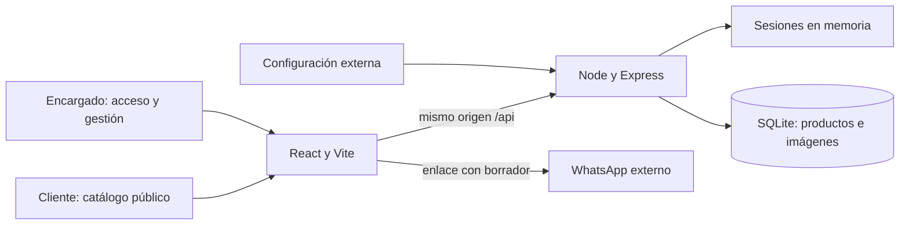

# Plan técnico: JM-STORE — Catálogo y pedidos por WhatsApp

**Rama**: `001-catalogo-pedidos-whatsapp` | **Fecha**: 2026-10-26 | **Spec**: [spec.md](spec.md)

**Entrada**: spec vigente, incluidas las dos aclaraciones de 2026-10-26; [AGENTS.md](../../AGENTS.md) y [Constitution 1.0.0](../../.specify/memory/constitution.md).

**Estado**: Plan completado documentalmente hasta la fase 1. Aplicación, pruebas de ejecución y aceptación pendientes. No se inicia Tasks ni Implement.

## Resumen

Catálogo público en React con Vite, una tarjeta por producto y solicitud individual mediante enlace de WhatsApp. El único encargado inicia sesión para agregar y eliminar productos. Un servidor Node.js sirve la web y la API bajo el mismo origen; SQLite conserva datos e imagen BLOB en la misma fila. Una escritura atómica evita anunciar un producto guardado sin su imagen.

Tres vistas, estado local de React, CSS convencional y SQL preparado. A-01 y A-06 excluyen edición, carrito, cantidades, pagos, cuentas de clientes, existencias, categorías, búsqueda, filtros, promociones, envíos, historial, seguimiento y actualización en tiempo real. Este plan no amplía el alcance aprobado.

## Contexto técnico

| Aspecto | Decisión para la implementación posterior |
| --- | --- |
| Lenguaje y ejecución | JavaScript ES modules y JSX; Node.js 24 LTS. Parches y lockfile se fijarán al inicializar. |
| Interfaz | React 19, Vite 8.3 y plugin oficial React; HTML semántico y CSS propio. No se presupone ninguna dependencia instalada. |
| Servidor | Express 5, un proceso. En producción sirve `dist/`, las rutas web y `/api/`; en desarrollo Vite reenvía `/api/` al servidor. |
| Dependencias servidor | `better-sqlite3` 13, Multer 2, Sharp 0.35 y `libphonenumber-js` con metadatos `max`; finalidades justificadas en [research.md](research.md). |
| Almacenamiento | Archivo SQLite fuera del código y `dist/`, con productos e imágenes BLOB. Precio en céntimos enteros. El navegador no es fuente del catálogo. |
| Sesiones | Token opaco aleatorio en cookie HttpOnly; hash en memoria del servidor, caducidad absoluta de ocho horas. Reiniciar exige volver a ingresar; los productos persisten. |
| Pruebas previstas | `node:test`: validación, persistencia y contratos HTTP. Playwright: recorridos web. Aceptación manual SC-001 a SC-009. Actualmente no existen comandos ni infraestructura de pruebas. |
| Plataforma | Navegadores actuales de celular, tablet y computadora. Servicio Node con disco persistente y HTTPS para internet. No se elige ni configura proveedor de alojamiento. |
| Rendimiento | Con 20 productos, primer grupo utilizable en ≤3 s en 4 de 5 aperturas; alta preparada ≤2 min y eliminación ≤30 s: SC-001, SC-003 y SC-004. |
| Restricciones | Un encargado, una imagen por producto, un destino comercial; sin servicios distribuidos, ORM ni colas. Anchos 360/768/1366 px, texto al 200 %, teclado, tacto y movimiento reducido. |

Al iniciar fase 0 se investigaron servidor/autorización, persistencia de imágenes, sesión revocable, validación del destino y pruebas/arranque. R-01 a R-09 de [research.md](research.md) resuelven esas decisiones. No quedan aclaraciones bloqueantes. Número comercial, credenciales y dominio son configuración externa que aporta el responsable; no se inventan valores reales.

## Comprobación de la Constitution

Puerta previa a fase 0: **CUMPLE**; spec y aclaraciones permiten diseñar el alcance sin contradicciones. Puerta posterior a fase 1: **CUMPLE**, con estas evidencias:

| Regla | Antes de investigar | Después del diseño |
| --- | --- | --- |
| I. Simplicidad | Un catálogo, un encargado y alta/eliminación. | Un proceso, una tabla con imagen, sesiones en memoria, tres vistas; alternativas y dependencias justificadas. |
| II. Idioma y mercado | FR-004 exige español de Perú y `S/ 49.90`. | Textos y borrador en español; formateador único; contrato de interfaz y V-06. |
| III. Cero alcance fantasma | FR-001–FR-019 y A-01–A-06 delimitan el producto. | Matriz completa; ningún módulo adicional. Gestión e imágenes conforme a Clarify. |
| IV. Verificable sin conocimientos técnicos | Nueve criterios y escenarios H1–H4. | [quickstart.md](quickstart.md) separa preparación técnica de acciones/resultados visibles; evidencia pendiente. |
| V. Datos con respeto | Sin datos de cliente; secretos externos. | Sin clientes/pedidos almacenados ni secretos en Vite; cookie protegida y autorización por servidor; registros limitados. |
| Límites del producto | WhatsApp, sin pagos. | Enlace con borrador, sin SDK comercial ni pasarela. |
| Stack vigente | React, Vite, SQLite; proyecto no inicializado. | Se mantienen; Node/Express permite SQLite y autorización desde internet. No se crean ejecutables en Plan. |

No hay infracciones que requieran excepción ni enmienda.

## Arquitectura y componentes



| Unidad | Responsabilidad |
| --- | --- |
| `Catalogo` | Cargar todos los productos y disponibilidad de WhatsApp; carga/vacío/error y reintento; sin controles de gestión. |
| `TarjetaProducto` | Imagen/reemplazo, textos completos, precio y pedido. Clave por ID, nunca por nombre. |
| `BotonWhatsApp` | Enlace codificado con datos visibles; deshabilitado con explicación si el destino no es válido. |
| `IniciarSesion` | Usuario y contraseña del encargado; error genérico. Sin registro ni recuperación. |
| `Gestion` | Verificar sesión antes de mostrar controles, listar para eliminar y ofrecer alta. Revalidar al entrar o restaurar la página. |
| `FormularioProducto` | Cuatro campos aprobados, previsualización, errores asociados y bloqueo en curso. Conservar borrador/archivo en memoria ante fallo. |
| `ConfirmarEliminacion` | Diálogo con nombre, cancelar/confirmar, foco controlado y confirmación bloqueada en curso. |
| API y utilidades cliente | `fetch` del mismo origen, formato de soles y mensaje común. Sin gestor global de estado ni biblioteca de consultas. |
| Acceso del servidor | Credenciales, emisión/revocación/caducidad de sesión, límite de intentos, CSRF y autorización de cada mutación. |
| Productos del servidor | Validación, tratamiento de imagen y SQL preparado; catálogo sin BLOB y ruta pública de imagen; éxito posterior al commit. |

### Rutas y entorno

- `/`: catálogo; `/encargado/ingresar`: acceso; `/encargado`: gestión. El servidor resuelve recargas de esas rutas; React selecciona vista por ruta y usa enlaces normales, sin router adicional. La gestión no muestra controles activos hasta verificar sesión.
- [contracts/api.openapi.yaml](contracts/api.openapi.yaml) define catálogo/imagen públicos, consulta/inicio/cierre de sesión, alta y eliminación. No hay endpoints de edición, pedidos ni administración de cuentas.
- Desarrollo previsto: Vite `http://localhost:5173`, API `http://127.0.0.1:3001`; el navegador usa `/api/` mediante proxy, conservando `Origin`.
- Producción: un origen HTTPS, un proceso y disco persistente local. Un alojamiento exclusivamente estático o disco efímero no satisface SQLite. No se diseña despliegue con varias instancias.
- SQLite: SQL preparado, `journal_mode=DELETE`, `synchronous=FULL`, espera de bloqueo de 5 s. No hay transacción abierta durante decodificación asíncrona. El listado consulta solo texto, precio e ID.
- Catálogo, imágenes y sesión: `Cache-Control: no-store`, para reflejar cambios en nuevas consultas. Sin service worker. Los recursos compilados con hash pueden usar caché normal.

### Acceso y protección

- `ADMIN_USERNAME` y `ADMIN_PASSWORD_HASH` solo llegan al servidor. Hash scrypt con salt aleatorio ≥16 bytes, `N=131072`, `r=8`, `p=1`, memoria suficiente, verificación asíncrona y comparación temporalmente constante. Configuración incompleta/mal formada impide habilitar gestión; sin contraseña predeterminada.
- Token de sesión de 32 bytes aleatorios; solo SHA-256 en una `Map` del servidor, sin identidad. Ocho horas absolutas, sin renovación automática. Logout elimina la entrada antes de responder. Reinicio invalida sesiones. Sin JWT, `localStorage` ni tabla de usuarios.
- Producción: cookie `__Host-jm_session`, `HttpOnly`, `Secure`, `SameSite=Strict`, `Path=/`, sin `Domain`. Solo para desarrollo local HTTP se usa `jm_session` sin `Secure`.
- Toda mutación exige `Origin` igual a `APP_ORIGIN` y `X-JM-STORE-Request: 1`; sin CORS a otros orígenes. Alta/eliminación requieren sesión antes de procesar imagen o escribir; revalidar inmediatamente antes del commit tras trabajo asíncrono.
- Login: cuerpo ≤4 KiB y hasta cinco fallos por origen de red en 15 minutos, después `429` con reintento. Contadores temporales en memoria; no registrar direcciones. Si existe proxy, confiar solo en el proxy concreto del entorno. Sin bloqueo permanente ni gestión de usuarios.
- Textos como JSX, nunca HTML. Errores con código, mensaje español y errores de campo permitidos. Sin cuerpos, cookies, contraseñas, hashes, imágenes, borradores ni datos personales en registros. Sin analíticas ni registro de cuerpos de peticiones.
- Tras logout, borrar estado de gestión y volver al acceso. En restauración desde historial verificar sesión antes de habilitar controles. Ante sesión vencida, el borrador puede mantenerse oculto en memoria para reingresar, sin persistirlo en el navegador.

### Datos e imágenes

[data-model.md](data-model.md) define entidades, validación y transiciones. UUID de servidor; nombres repetidos permitidos. Precio recibido como texto decimal y convertido por partes a céntimos, sin redondeo.

Subida: JPEG, PNG o WebP estático, ≤10 MiB y ≤25 millones de píxeles. Mostrar formatos/límites antes de seleccionar. Multer admite un archivo; Sharp decodifica completamente y conserva WebP sin redimensionar ni recortar, orientado conforme al original y sin metadatos. La copia también debe ser ≤10 MiB. Esto es tratamiento técnico, sin interfaz de edición. Ante fallo no se crea producto.

No se truncan textos visualmente. Límites defensivos UTF-8: nombre ≤4 KiB y descripción ≤32 KiB; mostrar ayuda, rechazar excesos por campo, nunca recortar. Son límites de recursos, no requisitos comerciales adicionales. Los textos largos admitidos deben superar SC-005.

### WhatsApp

`WHATSAPP_NUMBER`: configuración canónica internacional con `+`, máximo 15 dígitos y validación del plan numérico con `libphonenumber-js/max`. No se comprueba cuenta activa. Si falta/es inválido, catálogo operativo y pedido deshabilitado; no publicar el valor defectuoso.

Enlace directo `https://wa.me/<destino>?text=<texto codificado>` con los datos visibles al pulsar, sin consulta previa ni paso intermedio. [contracts/whatsapp.md](contracts/whatsapp.md) define mensaje y codificación. JM-STORE no guarda ni observa el envío.

### Diseño e interacción

[contracts/interfaz.md](contracts/interfaz.md) fija vistas, textos y accesibilidad. Base marfil, texto oscuro, verde profundo y acentos cálidos; tokens CSS y tipografía de sistema. Comprobar contraste antes de aceptar valores concretos.

Grid adaptable, espacio de imagen reservado, texto completo con saltos de palabras largas y sin alturas fijas que oculten contenido. Foco visible, etiquetas y objetivos táctiles ≥44 px. Transiciones de 150–200 ms, eliminando movimiento no esencial con `prefers-reduced-motion`. Sin carruseles ni ventanas promocionales.

## Estructura del proyecto

### Documentación de esta funcionalidad

```text
specs/001-catalogo-pedidos-whatsapp/
├── spec.md                     # Entrada existente; no modificada
├── checklists/requirements.md   # Revisión previa existente
├── plan.md
├── research.md
├── data-model.md
├── quickstart.md
└── contracts/
    ├── api.openapi.yaml
    ├── interfaz.md
    └── whatsapp.md
```

No se genera `tasks.md`. La lista de calidad previa a Clarify conserva referencias históricas; el alcance de Plan procede de los 19 FR y nueve SC de la spec vigente.

### Código previsto en la raíz, todavía inexistente

```text
src/
├── main.jsx
├── App.jsx
├── pages/                      # Catalogo, IniciarSesion y Gestion
├── components/                 # Tarjeta, formulario, diálogo y estados
├── lib/                        # API, precio y enlace WhatsApp
└── styles/                     # Tokens y CSS adaptable
server/
├── index.js                    # Arranque
├── app.js                      # Express y errores
├── config.js
├── db.js                       # Esquema y consultas
├── auth.js                     # Credenciales y sesión
├── productos.js                # Validación e imagen
└── routes/                     # Catálogo, sesión y productos
scripts/
└── configurar-acceso.mjs        # Preparación local sin secretos en argumentos
tests/
├── unit/                       # node:test
├── integration/                # HTTP y SQLite con node:test
├── e2e/                        # Playwright
└── fixtures/                   # Datos y fallos solo de pruebas
index.html
vite.config.js
playwright.config.js
package.json
package-lock.json
.env.example                    # Solo valores ficticios
.gitignore                      # Excluir secretos, SQLite y diarios
```

**Decisión de estructura**: un repositorio y un paquete npm; separación `src/`/`server/` sin servicios ni paquetes independientes. Esta estructura es diseño futuro, no código generado en Plan. `SQLITE_PATH` apunta a datos persistentes fuera del código.

## Fase 0 — Investigación

Se investigaron autenticación, persistencia/imágenes y cliente/WhatsApp con agentes de solo lectura, conforme a la habilidad Plan. [research.md](research.md) consolida decisiones, razones, alternativas y fuentes primarias consultadas el 2026-10-26. Los parches se fijarán y verificarán en Implement.

No quedan decisiones bloqueantes. Cerrar sesión al reiniciar simplifica el diseño: FR-011 exige persistencia de productos e imágenes, no de sesiones.

## Fase 1 — Modelo, contratos y verificación

Entregables: [modelo](data-model.md), [HTTP](contracts/api.openapi.yaml), [interfaz](contracts/interfaz.md), [WhatsApp](contracts/whatsapp.md) y [guía de validación](quickstart.md).

| Requisito | Decisión/contrato | Verificación prevista |
| --- | --- | --- |
| FR-001 | Catálogo completo y tarjeta por UUID. | V-01; SC-001. |
| FR-002 | Carga/vacío/error y reintento. | V-01, V-08; H1.2, H1.6. |
| FR-003 | Texto completo y reemplazo de imagen. | V-05, V-08; H1.4–H1.5. |
| FR-004 | Formato único y textos españoles. | V-06; SC-006. |
| FR-005 | Enlace directo por producto. | V-02; H2.1. |
| FR-006 | Mensaje exacto y codificación URL. | V-02; H2.1–H2.3. |
| FR-007 | Borrador transitorio, sin confirmar pedido. | V-02, V-06; H2.4. |
| FR-008 | Número validado y acción deshabilitada. | V-08; H2.5. |
| FR-009 | Catálogo público y gestión con sesión. | V-09; H3.6–H3.9. |
| FR-010 | Cuatro campos y validación servidor/cliente. | V-03, V-08; H3.1–H3.2. |
| FR-011 | SQLite atómico con imagen; éxito tras commit. | V-03, V-04; SC-003–SC-004. |
| FR-012 | Confirmación identificada y eliminación por ID. | V-04; H4.1–H4.3, H4.5. |
| FR-013 | Bloqueo en curso, fallo seguro, conservar borrador. | V-08; H3.4–H3.5, H4.4. |
| FR-014 | CSS adaptable sin desbordamiento. | V-05; SC-005. |
| FR-015 | Tokens, jerarquía, movimiento reducido. | V-07; SC-007. |
| FR-016 | Teclado, tacto, foco y texto al 200 %. | V-05; SC-005. |
| FR-017 | Sin datos de cliente; errores/registros limitados. | V-06, V-08; EC-07. |
| FR-018 | Sin pagos ni datos financieros. | V-06; SC-006. |
| FR-019 | Credenciales externas, autorización y logout revocable. | V-09 y HTTP directo; EC-08, SC-009. |

Pruebas técnicas prioritarias: importes, caracteres especiales, imagen corrupta, fallos de transacción, persistencia al reabrir SQLite, autorización directa/CSRF, expiración/revocación y repeticiones bloqueadas. Las pruebas de navegador cubrirán recorridos, sin instantáneas que solo reproduzcan componentes.

Los fallos se preparan desde pruebas o por el responsable, sin endpoints públicos ni pantallas de simulación. WhatsApp real se revisa sin enviar mensajes. Rendimiento, cinco participantes y dispositivos reales conservan aceptación manual. [quickstart.md](quickstart.md) define resultados observables.

## Seguimiento de complejidad

Sin violaciones. BLOB evita coordinar archivos y base de datos; sesiones en memoria evitan persistencia no requerida. Runner incorporado de Node y Playwright son las dos capas de pruebas. El plan termina tras fase 1 y comprobación posterior de Constitution; no genera Tasks ni implementa.

## Revisión documental de salida

Revisión realizada el 2026-10-26: siete artefactos de Plan presentes, contrato OpenAPI válido con siete operaciones, enlaces locales comprobados y cobertura de FR-001–FR-019 y SC-001–SC-009. Se verificó que spec, Constitution y AGENTS.md conservan su contenido original y que no existen código de tienda, `package.json` ni `tasks.md` generados por esta fase. No se ejecutaron pruebas de la aplicación; las evidencias de aceptación permanecen pendientes.

Se revisaron `before_plan` y `after_plan` en `.specify/extensions.yml`: ambos registran únicamente el hook opcional `speckit.git.commit`, habilitado y sin condición. Se informó su disponibilidad y se omitió su ejecución; no hay hooks obligatorios de Plan ni se creó commit.
