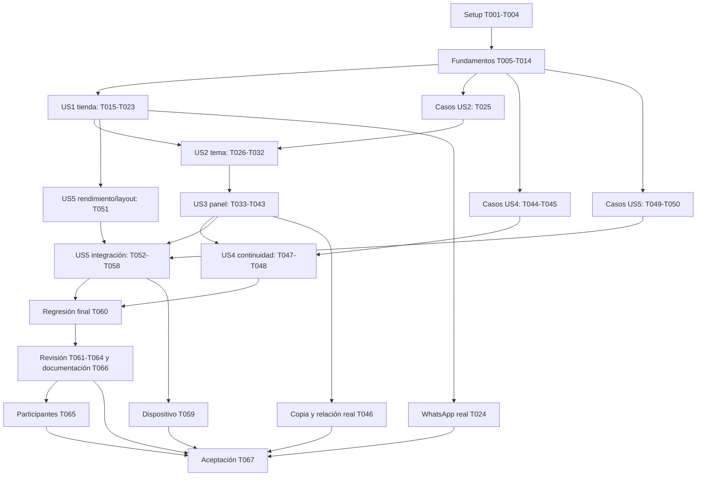

# Tasks: JM-STORE — Rediseño visual claro, oscuro y panel del encargado

**Rama de desarrollo**: `002-rediseno-visual` · **Fecha**: 2026-10-26 · **Fase actual**: Implement técnico verificado; cierre Git autorizado el 2026-10-27; aceptación externa pendiente.

**Input**: [spec y cinco aclaraciones](spec.md), [plan](plan.md), [research](research.md), [modelo](data-model.md), [contrato visual](contracts/interfaz-visual.md), [estado/navegación](contracts/estado-y-navegacion.md), [compatibilidad](contracts/compatibilidad.md) y [quickstart](quickstart.md). Rigen [AGENTS.md](../../AGENTS.md) y [Constitution 1.0.0](../../.specify/memory/constitution.md).

**Estado**: 62 tareas completas y cinco pendientes: T024, T046, T059, T065 y T067. Las casillas reflejan evidencia ejecutada. La spec, las cinco aclaraciones, plan.md y contratos permanecen intactos; quickstart registra ahora los resultados autorizados por T066.

**Cierre Git solicitado**: se aplica la convención de AGENTS.md por autorización expresa del usuario. La integración y retirada de la rama no completan T067 ni las cuatro validaciones externas de las que depende. Se conservan las cinco casillas pendientes y los criterios aprobados. Revisión y resultados de esta ejecución en [cierre-git.md](evidencia/cierre-git.md).

**Tests**: incluidos porque la spec, el plan y la petición exigen verificaciones de fidelidad, accesibilidad, rendimiento, compatibilidad y regresión. Escribir primero los casos nuevos que correspondan al comportamiento por construir y comprobar su fallo significativo antes del cambio; conservar verdes los casos ya satisfechos y las regresiones existentes, sin provocar fallos artificiales ni rebajar los criterios.

**Organization**: fases por historia y prioridad exactas de la spec: US1/US2/US3/US4 son P1; US5 es P2. Las bases comunes habilitan una prueba independiente de cada historia. Ninguna fase añade nuevas entidades comerciales, API, rutas, dependencias o infraestructura.

## Format: `[ID] [P?] [Story] Description`

- Todas las tareas usan `- [ ] TNNN`, ruta concreta y dependencias explícitas. `[USn]` identifica la historia de la spec; Setup, Foundational y cierre no llevan historia.
- `[P]` permite trabajo paralelo solo una vez satisfechos sus predecesores, con archivos de escritura diferentes y recursos de prueba independientes. Los ejemplos inferiores indican grupos seguros; no lanzar dos servidores/ejecuciones del lanzador en el mismo puerto/temporal.
- `Dep.: ninguna` identifica la entrada. Las demás dependencias son IDs; una tarea pendiente no se satisface porque exista un archivo vacío o un resultado simulado.
- Las tareas externas T024, T046, T059 y T065 pueden quedar pendientes por falta de acceso, copia aislada, dispositivo o participantes. Registrar la condición sin marcarlas completas; continuar las tareas independientes cuyos predecesores estén satisfechos. Bloquean la aceptación final T067, no el desarrollo técnico de otras historias.

## Path Conventions

Rutas relativas a `C:\JM-STORE`; usar rutas absolutas resueltas al operar archivos. Aplicación única existente: `src/`, `server/`, `tests/`, `public/assets/`. `evidencia/` se creará bajo esta feature solo al ejecutar trabajo real; no contiene resultados de pruebas hoy.

Conservar `server/`, `src/lib/api.js`, `src/lib/precio.js`, `src/lib/whatsapp.js`, `package.json`, `package-lock.json`, `.env`, credenciales, destino comercial y la base/imágenes reales. No ejecutar reset/seed/migraciones contra el catálogo real. Las eliminaciones del producto solo se ensayan en temporales o copia de aceptación aislada. Una tarea se completa con su resultado observable, no con cambios de esos límites.

## Phase 1: Setup — Preparar el proyecto existente

**Purpose**: establecer un punto de comparación reproducible, recursos de diseño y pruebas aisladas; no crear otro proyecto.

- [X] T001 Registrar rama, versiones fijadas, estado inicial del working tree y hashes de contratos/código protegido en `specs/002-rediseno-visual/evidencia/estado-previo.md`, distinguiendo cambios previos y excluyendo contenido de `.env`, credenciales, cookies y datos personales; identificar la base funcional 001 y sus aceptaciones pendientes sin alterarlas. Dep.: ninguna.
- [X] T002 Verificar Node 24 y preparar exclusivamente dependencias/navegadores existentes mediante los comandos de `specs/002-rediseno-visual/quickstart.md`; ejecutar `npm test` y `npm run test:e2e` como línea base aislada y registrar fallos previos/resultado en `specs/002-rediseno-visual/evidencia/entorno.md`, sin recrear configuración ni ejecutar `configurar-acceso`. Dep.: T001.
- [X] T003 [P] Preparar fotografías de prueba autorizadas horizontal/vertical/cuadrada y datos con UUID deterministas, textos largos, caracteres especiales, nombres iguales y 20 productos en `tests/fixtures/catalogo-visual.mjs`, `tests/fixtures/imagenes.mjs` y `tests/fixtures/navegador.mjs`; preservar el aislamiento y limpieza de temporales y permitir casos sin restauración intermedia, sin importar estos datos al catálogo real. Dep.: T002.
- [X] T004 [P] Incorporar la distribución Manrope variable OFL indicada en research R-05 como `public/assets/manrope-variable-v1.ttf` y `public/assets/manrope-OFL-v1.txt`; registrar fuente primaria, revisión y SHA-256 en `specs/002-rediseno-visual/evidencia/activos.md`, sin CDN, conversión de imágenes ni paquete nuevo. Dep.: T002.

**Checkpoint**: línea base documentada y recursos de ensayo listos. Si una prueba previa falla, resolver su causa dentro del alcance autorizado o documentar el impedimento antes de atribuirla al rediseño; no ocultarla cambiando umbrales.

## Phase 2: Foundational — Bases comunes bloqueantes

**Purpose**: instalar el lenguaje visual y las primitivas compartidas necesarias para las cinco historias. El arranque y la alternancia local quedan listos; US2 completa persistencia y seguimiento dinámico de la preferencia.

- [X] T005 [P] Sustituir en `tests/unit/contraste.test.js` el acoplamiento a verde/marfil y `.arte-sello` por casos de ambos temas, superficies, degradados, foco y estados; mantener texto normal ≥4.5:1 y texto grande/indicadores necesarios ≥3:1, incluyendo disabled sin reducción global de opacidad. Dep.: T003, T004.
- [X] T006 [P] Crear `tests/unit/tema.test.js` para ejecutar el bootstrap real en contexto aislado de Node y comprobar almacenamiento válido/inválido/ausente/denegado, dispositivo y caída a claro; fijar la clave `jm-store.tema` al dominio «`claro` u `oscuro`», sin nueva librería de DOM ni acceso a datos de la tienda. Dep.: T003, T004.
- [X] T007 [P] Implementar los tokens semánticos claros/oscuros, `color-scheme`, respaldo al sistema sin atributo y Manrope local con `font-display: swap` en `src/styles/tokens.css` y `src/styles/base.css`, respetando todos los valores/rangos del contrato visual y los pares de T005; no invertir colores ni añadir recursos remotos. Dep.: T005, T006.
- [X] T008 [P] Crear `public/assets/tema-inicial-v1.js` e incorporarlo en el `head` de `index.html` como script clásico externo antes de React, sin inline/async/defer; resolver la preferencia antes del contenido, proteger lecturas y aplicar atributos/metadatos sin peticiones o registro de valores; comprobar URL `/assets/tema-inicial-v1.js` en dev y compilación, sin tocar CSP/Express. Dep.: T005, T006.
- [X] T009 Crear `src/tema/ProveedorTema.jsx` y montarlo una sola vez en `src/main.jsx`, adoptando los atributos iniciales y alternando sin remontar `App`; fijar `temaEfectivo` a «`claro` / `oscuro`», `origenTema` a «`sistema` / `manual`» y preferencia del dispositivo a «Oscuro / no oscuro / no reconocible», sin claves React por tema, limpieza de campos ni refetch. Dep.: T007, T008.
- [X] T010 [P] Crear el botón accesible `src/components/InterruptorTema.jsx`, añadir únicamente los iconos necesarios en `src/components/Icono.jsx` y su presentación en `src/styles/marco.css`: nombre «Modo oscuro», `role=switch`, `aria-checked`, sol/luna, teclado/tacto, foco y objetivo ≥44 × 44; conectar la alternancia local al proveedor, sin tercera opción. Dep.: T009.
- [X] T011 [P] Crear `src/components/ImagenProducto.jsx` y las variantes de recuadro en `src/styles/productos.css` para foto completa con `contain`, proporción reservada, espacio alrededor y reemplazo identificable; admitir URL propia/preview existente y preservar callbacks de carga/error y prioridades, sin recorte, deformación, eliminación de fondos o transformación del archivo. Dep.: T009.
- [X] T012 [P] Unificar controles y estados estáticos compartidos en `src/styles/base.css`: reposo, secundario, destructivo, foco, ocupado, disabled y avisos legibles por tema; mantener áreas accionables, etiquetas y errores asociados sin dependencia de hover/color y sin mover formularios, diálogos o controles enfocados. Dep.: T009.
- [X] T013 Adaptar `src/components/Marco.jsx` y `src/styles/marco.css` para marca JM-STORE, lema, enlaces reales, salto al contenido, selector visible y espacio de cabecera coherente en las tres rutas, manteniendo identidad/posición del subárbol y accesibilidad; no introducir menús de funciones excluidas. Dep.: T010, T011, T012.
- [X] T014 Ejecutar las comprobaciones fundacionales de arranque, contraste y alternancia en compilación usando los comandos existentes; registrar resultados y CSP intacta en `specs/002-rediseno-visual/evidencia/fundamentos.md`, verificando que catálogo, acceso y gestión originales siguen operables antes de rediseñar su composición. Dep.: T007, T008, T009, T010, T011, T012, T013.

**Checkpoint**: primitivas reales, sin stubs ni contenido oculto permanente. Ninguna historia empieza su integración antes de este punto; US2 aún debe verificar/completar persistencia, eventos y conservación de trabajo.

## Phase 3: User Story 1 — Explorar la tienda y solicitar un producto (Priority: P1)

**Goal**: tienda pública fiel a RV-01/RV-02, con portada real, tarjetas completas y pedido individual conservado.

**Independent Test**: con tres productos conocidos y 20 de ensayo, consultar claro/oscuro, revisar todos los datos, formatos de foto y estados; abrir los borradores sin envío. La apariencia inicial puede fijarse con la preferencia del dispositivo/visita de prueba, sin esperar la integración avanzada de US2.

### Tests for User Story 1

- [X] T015 [P] [US1] Crear los casos públicos de `tests/e2e/presentacion.spec.js` con fixtures de T003 para portada, listado único/orden, fotografía completa, estados vacío/carga/error/reintento/imagen fallida y disposición 360/768/1366; preparar capturas estables a 1672 × 941 y mediciones de los VR públicos, sin asumir coincidencia píxel a píxel con las ilustraciones. Dep.: T014.
- [X] T016 [P] [US1] Ampliar `tests/e2e/whatsapp.spec.js` para tres productos distintos en ambos temas, incluidos tildes y `&`/`+`, destino ausente/inválido, vuelta al catálogo y borrador correcto en una activación; conservar `src/lib/whatsapp.js` y sus pruebas de codificación, sin envío automático ni pedido guardado. Dep.: T014.

### Implementation for User Story 1

- [X] T017 [P] [US1] Crear `src/components/PortadaCatalogo.jsx` y rediseñar `src/styles/catalogo.css` con la geometría RV-01/RV-02: título fuerte con énfasis degradado, texto/CTA izquierda, fotografía real/plataforma/halo derecha y franja Explora/Elige/Pide por WhatsApp; objetivo desktop 460 px y 44/56 dentro de rangos, con adaptación y composición neutra sin productos. Dep.: T015, T016.
- [X] T018 [P] [US1] Rediseñar `src/components/TarjetaProducto.jsx` y `src/styles/productos.css` con recuadro fotográfico completo, textos sin truncar, precio protagonista y acabado claro/oscuro; radio objetivo 20 px y foto/datos 40/60 en computadora, vertical en celulares/tablets y rejilla una/dos/tres columnas, preservando ID y carga prioritaria/diferida actual. Dep.: T015, T016.
- [X] T019 [P] [US1] Adaptar `src/components/EstadoCatalogo.jsx` y los avisos de `src/styles/base.css` para estados visuales diferenciados en ambos temas, con nombres accesibles, reemplazo y reintento actuales; no sustituir fallos por vacío ni anunciar éxito al fallar. Dep.: T015, T016.
- [X] T020 [US1] Integrar portada, franja, estados y única rejilla en `src/pages/Catalogo.jsx` reutilizando la respuesta existente: primer objeto para portada y primeras tres tarjetas protagonistas; conservar `ORDER BY id`, mostrar todos una vez y no crear filtro, sorting, bandera, consulta adicional o producto ficticio. Dep.: T017, T018, T019.
- [X] T021 [US1] Aplicar los botones de pedido degradados en claro y verde accesible en oscuro en `src/components/BotonWhatsApp.jsx` y `src/styles/productos.css`, conservando enlace, texto «Pedir por WhatsApp», motivo de indisponibilidad y bloqueo existentes; iconos, sombra y foco no cambian destinatario, precio ni rectángulo accionable. Dep.: T018.
- [X] T022 [US1] Ejecutar los recorridos públicos y de WhatsApp interceptado sobre SQLite temporal, corregir en los archivos anteriores cualquier incumplimiento y registrar resultados de H1/V-01/V-03/V-09 en `specs/002-rediseno-visual/evidencia/us1-pruebas.md`; comprobar cero/uno/dos/20 productos y nombres/descripciones extensos sin duplicados. Dep.: T020, T021.
- [X] T023 [US1] Comparar tienda clara con RV-01 y oscura con RV-02 a 1672 × 941: documentar las 16 comprobaciones públicas de SC-001, medidas, capturas y adaptaciones permitidas en `specs/002-rediseno-visual/evidencia/fidelidad-publica.md`; corregir diferencias en portada/tarjetas/cabecera dentro de los rangos, sin reintroducir controles excluidos. Dep.: T022.
- [ ] T024 [US1] Validar externamente los seis borradores reales de SC-003, sin enviar mensajes, con destino autorizado y acceso al servicio ya preparados; registrar resultado o impedimento en `specs/002-rediseno-visual/evidencia/whatsapp-real.md`, manteniendo pendiente esta tarea si falta acceso y sin modificar credenciales/configuración ni sustituirla por la intercepción. Dep.: T022.

**Checkpoint**: incremento técnico público verificable con T022/T023; T024 es evidencia externa obligatoria para aceptar toda la feature y no bloquea historias independientes.

## Phase 4: User Story 2 — Elegir y conservar la apariencia (Priority: P1)

**Goal**: completar el tema manual/automático en todas las pantallas, con almacenamiento protegido, reentrada y trabajo intacto.

**Independent Test**: alternar en tienda/acceso/gestión, recargar/reabrir y usar Atrás; cambiar preferencia del dispositivo antes/después de elegir manualmente y con almacenamiento denegado, campos escritos y diálogo abierto. Ninguna consulta/mutación comercial ocurre por tema.

### Tests for User Story 2

- [X] T025 [P] [US2] Crear `tests/e2e/tema.spec.js` con el contrato de estado en las tres rutas: carga fría, ambas preferencias iniciales, persistencia/reapertura, eventos del dispositivo, prioridad manual, lectura/escritura denegadas y ningún refetch por selector; añadir casos de campos/archivo/preview/foco y confirmación abierta, con animaciones normales para detectar destello. Dep.: T014.

### Implementation for User Story 2

- [X] T026 [US2] Completar el seguimiento dinámico del dispositivo en `src/tema/ProveedorTema.jsx`: suscripción a `matchMedia`, aplicar ambas direcciones solo con origen sistema y limpiar listeners con `StrictMode`; mantener foco/operaciones y no introducir opción Automático ni sincronización entre pestañas. Dep.: T025.
- [X] T027 [US2] Completar la conservación manual en `src/tema/ProveedorTema.jsx` usando exclusivamente `jm-store.tema` y «`claro` u `oscuro`»; proteger escritura/lectura, mantener origen manual en memoria si fallan y no restablecerlo por un evento posterior del dispositivo. Dep.: T026.
- [X] T028 [US2] Reconciliar el tema al regresar por historial en `src/tema/ProveedorTema.jsx` y verificar coherencia con `public/assets/tema-inicial-v1.js` e `index.html`; preservar la elección válida o la memoria manual si el almacenamiento falla, los nodos React y las comprobaciones de sesión existentes, sin scripts inline ni invalidar la caché con contenido distinto bajo el mismo nombre. Dep.: T027.
- [X] T029 [US2] Comprobar y corregir únicamente acoplamientos de presentación en `src/pages/Gestion.jsx`, `src/components/FormularioProducto.jsx` y `src/components/ConfirmarEliminacion.jsx` para que el tema conserve campos, `File`/blob, selección y foco; no usar claves por tema, remontar el formulario oculto al revalidar, recrear el diálogo o modificar autorización. Dep.: T028.
- [X] T030 [US2] Completar en `tests/e2e/tema.spec.js` los casos de restauración real con Atrás, fallo del bootstrap y CSP/activos en compilación Express; verificar cambio automático dentro del mismo modal sin acceso al interruptor externo y disponibilidad estática ante fallo del recurso. Dep.: T028.
- [X] T031 [US2] Ejecutar los casos de tema y bootstrap junto a las regresiones afectadas, medir respuesta ≤0.5 s y registrar campos/foco/solicitudes antes y después en `specs/002-rediseno-visual/evidencia/us2-pruebas.md`; comprobar seis cambios manuales, seis automáticos y diez puntos de persistencia de SC-002 sin rebajar la prueba por un screenshot final. Dep.: T023, T029, T030.
- [X] T032 [US2] Realizar V-02 desde la app con dos visitas/perfiles de prueba, con y sin preferencia conservable, y documentar la conformidad de H2.1–H2.7 en `specs/002-rediseno-visual/evidencia/tema-aceptacion.md`, sin datos de acceso reales ni cambios comerciales. Dep.: T031.

**Checkpoint**: tema completo e independiente del rediseño específico del panel. El acceso y diálogo actuales bastan para probar conservación de estado antes de US3; después se repite la regresión afectada.

## Phase 5: User Story 3 — Gestionar el catálogo en un panel profesional (Priority: P1)

**Goal**: aplicar RV-03 y su adaptación oscura al acceso, formulario y listado, manteniendo las operaciones vigentes.

**Independent Test**: con credenciales ficticias y dos productos en temporal, probar acceso directo/incorrecto/correcto, alta con foto, validaciones, cancelación/eliminación, fallos, vencimiento, cierre y regreso con Atrás en ambos temas.

### Tests for User Story 3

- [X] T033 [P] [US3] Ampliar `tests/e2e/acceso.spec.js` y `tests/e2e/alta-producto.spec.js` con el contrato visual del panel/acceso, cuatro campos vigentes, vista previa completa, datos conservados al fallar y cambio de tema mientras se trabaja; conservar pruebas de rechazo, sesión, bloqueo de repetición y límites, sin incorporar stock, categoría, edición ni credenciales nuevas. Dep.: T014, T032.
- [X] T034 [P] [US3] Ampliar `tests/e2e/eliminacion-producto.spec.js` para el panel nuevo en ambos temas: nombres iguales con ID distinto, cancelar/confirmar, repetición/fallo, último producto, foco y cambio automático de tema con modal abierto, conservando resultados y permisos actuales. Dep.: T014, T032.

### Implementation for User Story 3

- [X] T035 [P] [US3] Crear `src/components/NavegacionEncargado.jsx` y su marco en `src/styles/gestion.css`: marca, gestión activa luminosa y vuelta a tienda; sidebar azul noche en computadora, franja superior compacta en móvil/tablet, sin estadísticas, configuración, pedidos guardados o menús vacíos. Dep.: T033, T034.
- [X] T036 [P] [US3] Rediseñar el acceso en `src/pages/IniciarSesion.jsx` y `src/styles/acceso.css` para ambos temas, con jerarquía, campos, errores y acciones de la nueva identidad, preservando rutas, labels, solicitud vigente y estado escrito al cambiar apariencia. Dep.: T033, T034.
- [X] T037 [P] [US3] Modernizar `src/components/FormularioProducto.jsx` y `src/styles/formulario.css`: panel, título/icono, cuatro campos, carga y vista previa completa mediante el componente común, botón destacado y ayudas/errores; conservar las validaciones/callbacks actuales, `File`/blob y bloqueo, sin adoptar los límites o campos de la imagen de muestra. Dep.: T033, T034.
- [X] T038 [P] [US3] Rediseñar `src/components/ConfirmarEliminacion.jsx` y `src/styles/dialogo.css` manteniendo `showModal`, producto/ID, Cancelar con foco inicial, ciclo Tab, Escape según estado, bloqueo y retorno del foco; colorear en ambos temas sin animar/reabrir el diálogo por apariencia ni alterar la eliminación. Dep.: T033, T034.
- [X] T039 [US3] Integrar navegación, título/cierre, banda de resultado, formulario y listado en `src/pages/Gestion.jsx` y `src/styles/gestion.css`: sidebar objetivo 17 %, paneles 37/63, miniaturas completas, textos y precio actuales y eliminar; conservar el subárbol montado durante verificación y ninguna operación nueva. Dep.: T035, T036, T037, T038.
- [X] T040 [US3] Verificar y corregir la integración de `src/pages/Gestion.jsx` y `src/components/FormularioProducto.jsx` tras el nuevo marco: validaciones asociadas, archivo intacto durante tema/revalidación/fallo, imagen persistente tras alta y exactamente una creación; mantener acceso, cierre, protección directa, mensajes seguros y refetch solo donde ya corresponde a operaciones. Dep.: T039.
- [X] T041 [US3] Completar la adaptación del panel en `src/styles/gestion.css`, `src/styles/formulario.css` y `src/styles/acceso.css`: a 360/768 navegación compacta arriba, formulario primero y listado debajo; a 1366 sidebar y paneles paralelos; texto completo y acciones disponibles al 200 %, sin ocultar desbordes de página. Dep.: T040.
- [X] T042 [US3] Ejecutar los recorridos administrativos, fallos y sesión de V-04/V-09 en ambos temas con las bases temporales existentes; comprobar alta preparada ≤2 min y eliminación ≤30 s y registrar pruebas/foco/resultado en `specs/002-rediseno-visual/evidencia/us3-pruebas.md`, manteniendo la configuración real intacta. Dep.: T041.
- [X] T043 [US3] Comparar panel claro con RV-03 y oscuro con su adaptación aprobada a 1672 × 941 y registrar las 12 comprobaciones de SC-001 en `specs/002-rediseno-visual/evidencia/fidelidad-panel.md`, incluidos formulario, miniaturas, filas, avisos y botón de salida; corregir diferencias sin copiar controles o datos excluidos. Dep.: T042.

**Checkpoint**: administración existente completa, protegida y rediseñada; las 16 comprobaciones públicas y 12 de panel cubren la matriz visual antes del acabado transversal.

## Phase 6: User Story 4 — Conservar productos y datos (Priority: P1)

**Goal**: demostrar continuidad de productos, imágenes, contratos y configuración sin migraciones o reinicio del catálogo.

**Independent Test**: comparar relación legible, ID, orden, datos y hashes de una copia aislada antes/después, sin reset intermedio; recargar, abrir otra sesión/dispositivo y reiniciar el servidor preparado. Ensayar alta/eliminación solo de un producto ficticio en ese entorno.

### Tests and verification for User Story 4

- [X] T044 [P] [US4] Extender `tests/e2e/persistencia.spec.js` con un caso dedicado sobre SQLite temporal/copia de prueba sin restauración intermedia: preservar `id` como «Identidad estable incluso con nombres iguales; no regenerar.» y comprobar orden, esquema, textos, precio e imagen antes/después de usar el frontend, recarga, nueva sesión y reinicio; agregar/eliminar solo un producto ficticio y reautenticar si el reinicio revoca la sesión. Dep.: T014.
- [X] T045 [P] [US4] Verificar y completar solo la cobertura necesaria en `tests/integration/catalogo.test.js`, `tests/integration/alta-producto.test.js` y `tests/integration/eliminacion-producto.test.js` conservando literalmente las restricciones del modelo: `nombre`, «Distinto de espacios; máximo 4096 bytes.»; `descripcion`, «Distinto de espacios; máximo 32768 bytes; mostrar completo y como texto.»; `precio_centimos`, «Entre 1 y 9007199254740991; vista pública `precioCentimos`. No convertir a precio decimal almacenado.»; `imagen`, «Entre 1 y 10485760 bytes; no sustituir ni recodificar los existentes.»; `imagen_mime`, «Texto `image/webp`» y «Servir por la ruta de imagen actual, no por URL remota.»; `imagenUrl`, «`/api/productos/:id/imagen`; no columna nueva.». Mantener además JPEG/PNG/WebP estático de hasta 10 MiB y 25 millones de píxeles y precio decimal vigente, sin cambiar servidor/esquema para esta tarea. Dep.: T014.

### Integration and evidence for User Story 4

- [ ] T046 [US4] Obtener del responsable la copia coherente y aislada del catálogo previo y su relación visible; ejecutar la comparación humana de V-08 y registrar coincidencia de todos los productos/imágenes y el impedimento si falta ese entorno en `specs/002-rediseno-visual/evidencia/conservacion-catalogo.md`; no abrir la base real desde fixtures, copiar un SQLite activo inconsistentemente, limpiar datos o tratar una semilla nueva como prueba de conservación. Dep.: T001, T043.
- [X] T047 [US4] Ejecutar el caso dedicado y las regresiones SQLite/HTTP de T044/T045, comparar ID, orden, esquema y SHA-256 de imágenes sin operaciones entre ambas lecturas y registrar resultados en `specs/002-rediseno-visual/evidencia/us4-pruebas.md`; comprobar copia persistente al retirar solo el archivo original de prueba y ausencia persistente del producto ficticio eliminado. Dep.: T043, T044, T045.
- [X] T048 [US4] Auditar el diff contra T001 y la continuidad de `server/db.js`, `server/app.js`, `server/auth.js`, `src/lib/api.js`, `src/lib/precio.js`, `src/lib/whatsapp.js`, `package.json` y `package-lock.json`; registrar en `specs/002-rediseno-visual/evidencia/continuidad.md` que no hay migración, reset, credenciales/configuración alteradas, endpoints nuevos o cambios de codificación/seguridad, sin publicar secretos ni convertir esta verificación en una operación de mantenimiento. Dep.: T047.

**Checkpoint**: continuidad técnica demostrada en temporal sin reset. T046 requiere la copia de aceptación real preparada; la ausencia de esa evidencia se mantiene visible y no invalida la posibilidad de continuar pruebas independientes.

## Phase 7: User Story 5 — Adaptación, accesibilidad y movimiento moderado (Priority: P2)

**Goal**: completar la experiencia fluida y accesible en todos los tamaños y motores previstos, preservando controles, datos y preferencias.

**Independent Test**: completar los seis flujos a 360/768/1366 en ambos temas, teclado/tacto, texto al 200 %, normal/reducido y recorridos repetidos; medir cinco aperturas por tema con 20 productos y comprobar los motores básicos además de Chromium.

### Tests for User Story 5

- [X] T049 [P] [US5] Crear `tests/e2e/movimiento.spec.js` para aparición una vez por visita, ausencia de repetición por scroll/tema/validación/actualización ajena, nueva visita y Atrás, foco inmediato, preferencia reducida dinámica y fallback sin `IntersectionObserver`; observar resultados/eventos con efectos normales, no solo clases CSS ni capturas con animaciones desactivadas. Dep.: T014.
- [X] T050 [P] [US5] Ampliar `tests/e2e/accesibilidad.spec.js` para ambos temas, seis flujos, ampliación 200 %, teclado, objetivos ≥44 × 44, foco, mensajes y modal; añadir mediciones de estados/degradados necesarios y el reflujo de tarjetas/panel, sin exigir a estas pruebas que sustituyan lectura asistida o dispositivo físico. Dep.: T014.
- [X] T051 [P] [US5] Ampliar `tests/e2e/catalogo.spec.js` y `tests/e2e/limites.spec.js` con las seis combinaciones tema/ancho, límites 639/640/1199/1200, foto completa/textos largos y las cinco aperturas por tema con 20 productos en condiciones registradas; medir primer grupo y estabilidad al pulsar sin esperas artificiales de screenshot. Dep.: T023.

### Implementation for User Story 5

- [X] T052 [P] [US5] Crear `src/hooks/useAparicion.js` y `src/styles/movimiento.css` con las reglas del modelo: «Reiniciar al abrir/volver; incluye restauración de historial.»; «Producto identificado por UUID; sección por ID semántico, no índice ni tema.»; «Una vez; retirarla al terminar/cancelar manteniendo el ID visto.»; «Desactivar movimiento en vivo; mostrar pendientes y no reproducir apariciones consumidas al desactivarlo.». Marcar visto antes del efecto, `unobserve`, limpiar clases/listeners/observadores, coordinar primera zona con entrada de pantalla y dejar contenido visible sin soporte. Dep.: T049, T050, T051.
- [X] T053 [P] [US5] Completar hover, foco, pulsación y transiciones de controles/tarjetas en `src/styles/base.css` y `src/styles/productos.css`: propiedades explícitas de color/borde/sombra, acabado interno sin mover el rectángulo clicable, duraciones 150–350 ms y respuesta estática con movimiento reducido; excluir loops, paralaje, `transition: all` y desplazamiento de formularios, diálogos o elementos enfocados. Dep.: T049, T050, T051.
- [X] T054 [US5] Integrar el hook y la entrada documental breve en `src/pages/Catalogo.jsx`, `src/pages/Gestion.jsx`, `src/pages/IniciarSesion.jsx` y `src/main.jsx`, distinguiendo entrada estable de pantalla de verificación temporal de sesión; preservar enlaces, anchors, historial, campos y selección, sin router nuevo, capturas entre pantallas protegidas o esperas antes de navegar. Dep.: T043, T052, T053.
- [X] T055 [US5] Ajustar solo los desbordes/fallos demostrados por las pruebas en `src/styles/marco.css`, `src/styles/catalogo.css`, `src/styles/productos.css`, `src/styles/gestion.css`, `src/styles/formulario.css`, `src/styles/acceso.css` y `src/styles/dialogo.css`; respetar exactamente tarjetas verticales en móvil/tablet, rejilla 1/2/3, panel apilado a 360/768 y lateral a 1366, texto completo/200 % y navegación sin ocultar contenido con overflow global. Dep.: T054.
- [X] T056 [US5] Ampliar `tests/e2e/basico.spec.js` para ejecutar en Firefox/WebKit las comprobaciones transversales de tema, fotos completas, layout, foco/modal y preferencia reducida en vivo, conservando los proyectos y lanzador de `playwright.config.js` sin afirmar que estos motores cubren toda la batería. Dep.: T055.
- [X] T057 [US5] Ejecutar los casos de movimiento, accesibilidad y recorridos básicos de los tres motores con el lanzador aislado; documentar comportamiento normal/reducido, repetición, fallback e historial en `specs/002-rediseno-visual/evidencia/accesibilidad-movimiento.md`, corrigiendo fallos dentro de los archivos anteriores sin bajar contraste ni omitir navegadores. Dep.: T056.
- [X] T058 [US5] Medir V-07 en el mismo dispositivo/conexión con cinco contextos nuevos por tema: primer grupo usable ≤3 s en ≥4/5, cambio de tema ≤0.5 s, 20 tarjetas sin duplicados ni salto al pulsar; registrar condiciones y todas las mediciones en `specs/002-rediseno-visual/evidencia/rendimiento.md`, sin excluir el arranque/fuente de la app ni optimizar recortando/reprocesando la base real. Dep.: T057.
- [ ] T059 [US5] Ejecutar externamente V-05/V-06 en celular físico/otro dispositivo con el HTTPS autorizado existente, tacto, teclado y lectura asistida en ambos temas; registrar dispositivo, acciones, foco y resultado en `specs/002-rediseno-visual/evidencia/dispositivos.md`, dejando la tarea pendiente si falta el entorno y sin introducir despliegue o cambios de credenciales. Dep.: T057.

**Checkpoint**: experiencia técnica completa con T057/T058; el ensayo físico/asistido T059 debe ejecutarse para aceptación y no se sustituye por emulación.

## Phase 8: Polish & Cross-Cutting Concerns — Verificación y cierre documental

**Purpose**: consolidar evidencia del rediseño completo y corregir las regresiones detectadas en sus tareas propietarias, sin crear alcance adicional ni cerrar Git automáticamente.

- [X] T060 Ejecutar la batería final `npm test` y `npm run test:e2e` —este último compila— y verificar build/activos en Express, conservando `tests/fixtures/ejecutar-web.mjs` y sus protecciones de limpieza; registrar resultado, informes y cualquier fallo pendiente en `specs/002-rediseno-visual/evidencia/regresion-final.md`, sin dar aprobación si falla un control pertinente. Dep.: T048, T058.
- [X] T061 [P] Revisar las capturas finales ya producidas y consolidar 28/28 comprobaciones de RV-01/RV-02/RV-03 con medidas, tipografía, paleta, fotografía, acabado, temas y adaptaciones permitidas en `specs/002-rediseno-visual/evidencia/fidelidad-final.md`; enlazar cada VR, sin sustituir la interfaz por fondos ni aprobar solo por tener degradados. Dep.: T060.
- [X] T062 [P] Revisar los resultados/capturas finales de los diez estados de V-09 en ambos temas y completar V-10 en `specs/002-rediseno-visual/evidencia/idioma-alcance-estados.md`: 20 resultados distinguibles, textos propios en español de Perú, patrón `S/ 49.90`, cero datos personales nuevos y cero controles de búsqueda/categorías/favoritos/stock/edición/estadísticas/pagos o módulos excluidos. Dep.: T060.
- [X] T063 Verificar arranque frío, rutas, CSP y carga local de `index.html`, `public/assets/tema-inicial-v1.js`, `public/assets/manrope-variable-v1.ttf` y su licencia sobre la compilación Express; registrar en `specs/002-rediseno-visual/evidencia/seguridad-activos.md` ausencia de inline/CDN/peticiones inesperadas, coherencia del nombre versionado con caché y recuperación visible al fallar el bootstrap, sin modificar la política de seguridad. Dep.: T060.
- [X] T064 Incorporar únicamente las capturas finales revisadas por el responsable como baselines de regresión en `tests/e2e/presentacion.spec.js-snapshots/` y documentar la revisión en `specs/002-rediseno-visual/evidencia/capturas-revisadas.md`; fijar motor/SO/fuente/datos y separar capturas estáticas de las pruebas normales de tiempos/movimiento, sin actualización masiva automática para esconder diferencias. Dep.: T061, T062, T063.
- [ ] T065 Ejecutar externamente V-11 con cinco personas nuevas en ambos temas y tres tarjetas: al menos cuatro identifican nombre, precio, pedido e interruptor en ≤30 s sin instrucciones; registrar tiempos por identificador ficticio y resultado en `specs/002-rediseno-visual/evidencia/participantes.md`, sin recopilar datos personales ni marcar aprobado el ensayo si falta participación. Dep.: T061.
- [X] T066 Actualizar los comandos/rutas realmente comprobados, enlaces a evidencia y estado efectivo en `specs/002-rediseno-visual/quickstart.md`, `README.md` y `specs/README.md`, conservando el historial y los pendientes de aceptación 001; reflejar explícitamente lo que pasa/falla/permanece pendiente, sin modificar requisitos, contratos o umbrales para acomodar resultados. Dep.: T060, T061, T062, T063.
- [ ] T067 Consolidar la decisión de aceptación en `specs/002-rediseno-visual/evidencia/aceptacion.md` con todos los FR, VR, SC, cinco aclaraciones y resultados de cada historia; completar solo cuando estén satisfechos también WhatsApp real, copia de catálogo, dispositivo y participantes, manteniendo la feature abierta y la tarea pendiente ante evidencia requerida ausente, sin commit/push/merge/cierre Git automáticos. Dep.: T024, T046, T059, T060, T061, T062, T063, T064, T065, T066.

**Checkpoint**: el producto solo está aceptado cuando sus pruebas y evidencia requeridas lo demuestran. Tasks no ejecuta ninguna de ellas; todas las casillas anteriores permanecen sin marcar en esta entrega.

## Dependencies & Execution Order

### Phase Dependencies

| Fase | Entrada técnica | Resultado y bloqueos reales |
| --- | --- | --- |
| 1 · Setup | T001 → T002 → T003/T004 | Base, fixtures y fuente; no inicializa otro proyecto. |
| 2 · Foundational | T003 y T004 | T005–T014 bloquean integración de historias. |
| 3 · US1 | T014 | Desarrollo público; T022/T023 habilitan validación técnica. T024 es externo. |
| 4 · US2 | Casos desde T014; cierre técnico tras T023 | T025–T032 completan el tema; T031 se apoya en tienda estable. |
| 5 · US3 | T014 y T032 | T033–T043 completan panel/acceso; no pisa proveedores en paralelo. |
| 6 · US4 | Casos desde T014; ejecución tras T043 | T047/T048 dan continuidad técnica; T046 es evidencia externa separada. |
| 7 · US5 | Casos desde T014/T023; integración tras T043 | T057/T058 validan experiencia técnica; T059 es externo. |
| 8 · Acabado | T048 y T058 para T060 | Regresión y evidencia final; T067 espera todos los ensayos requeridos. |

### User Story Dependencies

La secuencia numerada es ejecutable de principio a fin. El grafo muestra puertas de terminación e independencia de los casos; las dependencias de cada línea son la autoridad para empezar una tarea. No existe una dependencia futura o circular. Los ensayos externos pendientes no obligan a paralizar historias que no dependan de ellos.

### Within Each User Story

Preparar primero sus pruebas/casos y luego presentación, integración y verificación. No crear modelos, servicios o endpoints inexistentes para completar artificialmente la plantilla. Corregir un fallo en su tarea propietaria y repetir solo lo afectado antes de la batería final. Mantener la separación entre redacción paralela de pruebas y su ejecución aislada.

### Parallel Opportunities

| Grupo listo | Tareas paralelas | Escrituras separadas y condición |
| --- | --- | --- |
| Después de T002 | T003 / T004 | Fixtures frente a activos/fuente. |
| Después de T003/T004 | T005 / T006 | Dos archivos unitarios distintos. |
| Después de T005/T006 | T007 / T008 | Tokens/base frente a bootstrap/HTML. |
| Después de T009 | T010 / T011 / T012 | Interruptor/iconos/marco CSS; imagen/productos CSS; controles/base CSS. |
| Después de T014 | T015 / T016 / T025 / T044 / T045 / T049 / T050 | Casos por archivos distintos; no ejecutar lanzadores sobre el mismo temporal/puerto en paralelo. |
| Después de T015/T016 | T017 / T018 / T019 | Portada/catalogo CSS; tarjeta/productos CSS; estados/base CSS. |
| Después de T032 | T033 / T034 | Acceso/alta frente a eliminación. |
| Después de T033/T034 | T035 / T036 / T037 / T038 | Navegación, acceso, formulario y diálogo con hojas separadas. |
| Después de T023, con T014 listo | T049 / T050 / T051 | Movimiento, accesibilidad y catálogo/límites en archivos distintos. |
| Después de T049/T050/T051 | T052 / T053 | Hook/movimiento CSS frente a base/productos CSS. |
| Después de T060 | T061 / T062 | Revisión de capturas ya obtenidas; reportes separados, sin reset de datos. |

No paralelizar los escritores de `Marco.jsx`/`marco.css` entre T010/T013 y cambios posteriores; de `ProveedorTema.jsx` entre T026/T027/T028; de `tema.spec.js` entre T025/T030; ni de `Gestion.jsx` entre T029/T039/T040/T054. Lo mismo rige para las hojas comunes y pruebas reutilizadas: sus dependencias y puertas de fase serializan esas modificaciones. T055 no empieza mientras otro cambio de estilos de la historia correspondiente siga abierto.

## Parallel Examples by User Story

| Historia | Ejemplo permitido | Integración posterior |
| --- | --- | --- |
| US1 | Redactar T015/T016 en paralelo; después T017/T018/T019. | T020 une composición/datos y T022 verifica con el lanzador. |
| US2 | Redactar T025 junto a T044 y T049 desde T014, en archivos distintos. | T026 → T027 → T028 son secuenciales sobre el mismo proveedor; T031 verifica. |
| US3 | Redactar T033/T034; luego T035/T036/T037/T038. | T039 une el panel y T042 verifica sin competir por fixtures. |
| US4 | T044/T045 pueden prepararse independientemente del acabado del panel. | T047 espera T043 y ambos casos; T046 no se sustituye por una base nueva. |
| US5 | Redactar T049/T050/T051 con sus predecesores satisfechos; luego T052/T053. | T054 integra, T055 revisa tamaños y T057/T058 validan. |

## Trazabilidad de requisitos y decisiones

| Fuente aprobada | Tareas principales | Criterio/guía |
| --- | --- | --- |
| FR-001, FR-009, FR-010, FR-011 | T029, T033–T043, T044–T048 | SC-004, SC-008, SC-009; V-04/V-08/V-09. |
| FR-002, FR-003, FR-004 | T006, T008–T010, T013, T025–T032, T063 | SC-002; V-02. |
| FR-005, FR-006, FR-007 | T011, T015–T024, T037, T039 | SC-001, SC-003; V-01/V-03. |
| FR-008, FR-019 | T013, T035, T048, T062 | SC-010; V-10. |
| FR-012 | T019, T033/T034, T040, T062 | SC-009; V-09. |
| FR-013, FR-014, FR-016 | T005, T012, T038, T049/T050, T052–T059 | SC-006; V-06. |
| FR-015 | T018, T041, T050/T051, T055/T056, T059 | SC-005; V-05. |
| FR-017 | T004, T008, T051, T053, T058 | SC-007; V-07. |
| FR-018 | T001, T044–T048 | SC-008; V-08. |
| FR-020 | T023, T043, T061, T064, T067 | SC-001; V-01. |
| VR-001, VR-002, VR-003 | T007, T010, T013, T023, T035/T039, T043, T061 | Cabecera, temas y acabado. |
| VR-004, VR-005, VR-006 | T011, T017, T020, T023, T061 | Portada, escena fotográfica y franja. |
| VR-007, VR-008, VR-009 | T004/T007, T018, T021, T053, T061 | Tarjetas, botones y tipografía. |
| VR-010, VR-011, VR-012 | T035, T037–T043, T061 | Panel, formulario, listado y avisos. |
| Clarify 1 · Foto completa | T003, T011, T015, T017/T018, T037/T039, T061 | Sin recorte ni cambios de imagen guardada. |
| Clarify 2 · Tarjetas verticales | T018, T051, T055/T056 | Imagen arriba en celular/tablet; horizontal en computadora. |
| Clarify 3 · Una aparición/visita | T049, T052, T054, T057 | Sin repetición por tema, scroll o validación. |
| Clarify 4 · Sistema hasta manual | T025–T032, T063 | Cambios en vivo, prioridad manual y estado conservado. |
| Clarify 5 · Panel tablet apilado | T035, T039/T041, T050/T051, T055/T056 | Navegación arriba, formulario y listado debajo a 768. |
| Comprensión con personas | T065 | SC-011; V-11. |

Todos los escenarios H1.1–H1.8, H2.1–H2.7, H3.1–H3.8, H4.1–H4.4 y H5.1–H5.6 están cubiertos por sus fases; V-01 a V-11 definen las condiciones y resultados de los once SC. La matriz se usa para verificar evidencia, no para marcar aceptación por presencia de código.

## Implementation Strategy

### MVP First — Incremento técnico de US1

Completar Setup y Foundational, construir US1 y demostrar T022/T023: tienda clara/oscura, portada y tarjetas reales, selector local, fotos completas y enlace individual correcto. Es un incremento de demostración, no la aceptación total del rediseño: persistencia/seguimiento completo pertenece a US2, panel a US3, conservación a US4, experiencia transversal a US5 y evidencia externa a sus tareas. No desplegar ni cerrar la feature por completar ese MVP.

### Incremental Delivery

Después del incremento público, completar US2, US3 y la verificación de US4 en orden P1; finalizar US5 y el acabado. Los casos independientes pueden redactarse antes según el grafo. Cada checkpoint requiere observación/pruebas de su historia sobre el entorno aislado, manteniendo los flujos anteriores. La falta de evidencia externa se registra y no se convierte en una aprobación implícita.

### Parallel Team Strategy

Asignar únicamente grupos `[P]` listos y propietarios diferentes de archivos; integrar en las tareas que siguen al grupo. Un único responsable controla las ejecuciones que comparten servidor/fixtures. La posibilidad de paralelismo documentada no autoriza cambios fuera de alcance ni implica que Tasks lance agentes o ejecute trabajo.

## Notes

- Historial de Tasks: la lista original se entregó sin ejecutar código, instalaciones ni pruebas. Las casillas posteriores reflejan la fase Implement autorizada; la base real no se abrió ni reinició.
- Las fotos, productos y datos de las referencias solo orientan el diseño. Se conservan la oferta real, las copias propias de imágenes y los cuatro campos; no crear búsquedas, categorías, favoritos, stock, edición, promociones, estadísticas, pagos o historial de pedidos.
- En implementación, un fallo de aceptación se corrige en su tarea y se repite lo necesario; no alterar spec, Clarify, contratos, umbrales o checklist para acomodar resultados.
- Una casilla ejecutada necesita evidencia suficiente. WhatsApp interceptado, capturas estáticas, emulación y pruebas técnicas no sustituyen servicio real, movimiento en vivo, dispositivo ni participantes.
- No se aplica el cierre de feature de AGENTS.md mientras el usuario no lo solicite. Esta lista no autoriza commits, push, merge o despliegues automáticos.

## Registro de Implement — 2026-10-26

| Trabajo completado | Evidencia real |
| --- | --- |
| T001–T023 | Preparación/fundamentos, portada, tarjetas y WhatsApp interceptado; us1-pruebas y fidelidad pública |
| T025–T045 | Tema persistente/automático, panel, operaciones y pruebas de conservación |
| T047–T058 | Instantáneas idénticas, auditoría, movimiento, accesibilidad, responsive y rendimiento |
| T060–T064 | 33/33 Node, 140/140 E2E, 28 rasgos, 20 estados, seguridad y cuatro baselines revisadas 4/4 |
| T066 | README, quickstart y estado del producto actualizados con resultados y límites reales |

[Regresión final](evidencia/regresion-final.md): Chromium 134 casos; Firefox y WebKit tres recorridos básicos ampliados cada uno. La última ejecución posterior compara cuatro baselines en Chromium/Windows sin cambios adicionales a la app. Registro de perfil temporal cerrado/reabierto, seis cambios manuales y seis automáticos, foco/File/blob conservados, reducido dinámico y tres proporciones sin adornos encima, incluido texto 200 %.

Pendientes sin marcar: T024 (WhatsApp real autorizado), T046 (copia previa aislada y comparación humana), T059 (dispositivo/HTTPS/tacto/lector), T065 (cinco personas nuevas) y T067 (aceptación total). Detalle en [aceptacion.md](evidencia/aceptacion.md). No hubo modificaciones de credenciales, base real, servidor o dependencias; no se realizó commit, push, merge o cierre.
